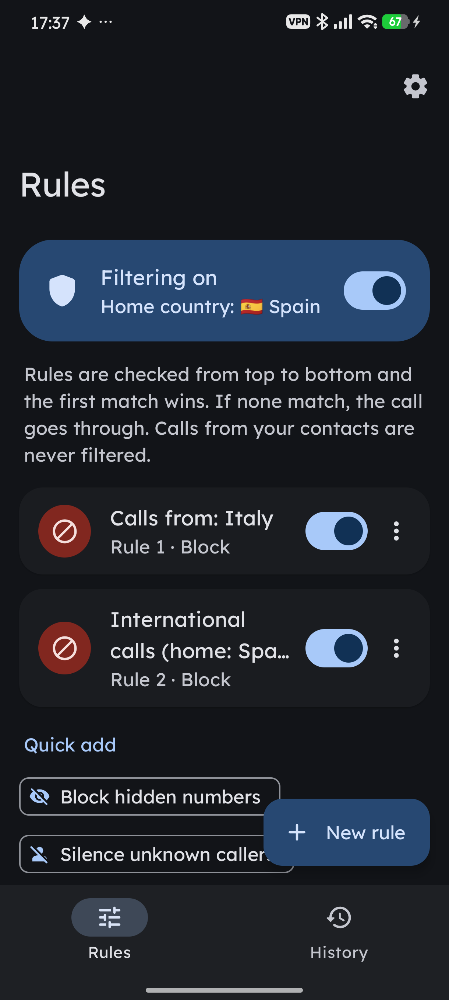
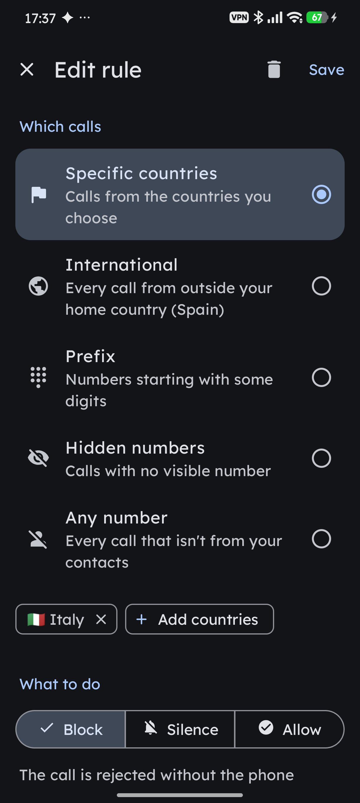
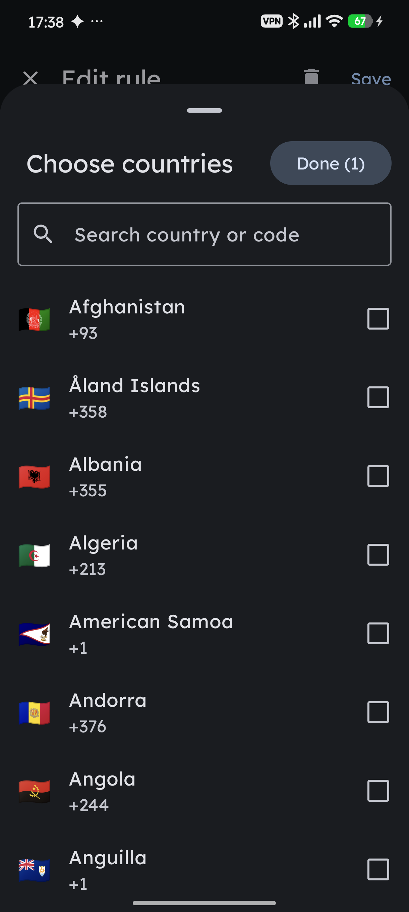
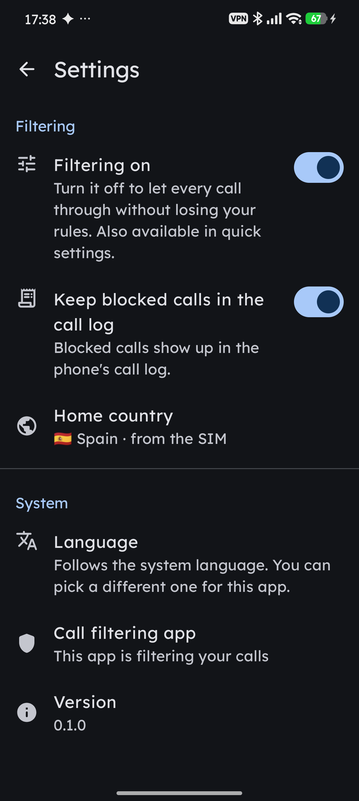

# Filtro de llamadas

*[Read in English](README.md)*

App Android que filtra las llamadas entrantes con reglas propias: bloquear países concretos,
quedarse solo con las llamadas nacionales, cortar los números ocultos, silenciar prefijos...
Está hecha en Kotlin con Jetpack Compose y Material 3, y se integra con el sistema: color
dinámico (Material You), tema oscuro, icono temático, mosaico de ajustes rápidos e idioma por app.

<p align="center">
  
  
  
  
</p>
<p align="center"><sub>Reglas · Editor · Selector de países · Ajustes</sub></p>

## Cómo funciona

La app usa la API del sistema `CallScreeningService`. Con el rol de «identificación de llamadas
y spam», Android le consulta cada llamada entrante que no sea de un contacto guardado, y la app
decide si la deja pasar, la silencia o la rechaza.

Las reglas se evalúan de arriba abajo y gana la primera activa que coincide. Si ninguna
coincide, la llamada pasa.

| Condición | Coincide con |
|---|---|
| Países concretos | números de los países elegidos (país detectado con libphonenumber) |
| Internacionales | cualquier país distinto del país de referencia («solo llamadas nacionales») |
| Prefijo | números que empiezan por unos dígitos; con `+` se compara con el formato internacional, sin `+` con el número nacional |
| Números ocultos | llamadas sin número o con el número restringido |
| Cualquier número | todas las llamadas que llegan al filtro |

| Acción | Efecto |
|---|---|
| Bloquear | la llamada se rechaza sin que suene el teléfono |
| Silenciar | la llamada entra sin sonar ni vibrar; se puede coger desde la pantalla |
| Permitir | pasa con normalidad; sirve para hacer excepciones por encima de otras reglas |

Otras funciones:

- **País de referencia**: sale de la SIM y se puede fijar a mano. Es el que define qué es
  «nacional».
- **Registro**: cada llamada que pasa por el filtro, con la regla que se le aplicó.
- **Ajustes rápidos**: un mosaico para pausar o reanudar el filtrado sin perder las reglas.
- **Logcat**: cada decisión se registra con el tag `CallRules`.

## Privacidad

Todo se queda en el teléfono. La app no pide permiso de internet, contactos ni registro de
llamadas. Reglas, ajustes e historial se guardan como JSON en su almacenamiento interno
(`rules.json` y `history.json`).

## Idiomas

Inglés (idioma de respaldo), español, francés, italiano, alemán y portugués. Por defecto sigue
el idioma del sistema; en Android 13+ se puede elegir otro solo para esta app desde
Ajustes → Idioma. AGP genera `locales_config.xml` a partir de las carpetas `values-xx`
(`generateLocaleConfig` + `res/resources.properties`), así que basta con añadir una carpeta
para sumar un idioma. Los nombres de los países salen del propio sistema en el idioma activo.

## Requisitos

- Android 10 (API 29) o superior.
- Para compilar: JDK 17 y el SDK de Android con la plataforma 36.

## Compilar e instalar

```bash
./gradlew :app:testDebugUnitTest
./gradlew :app:assembleDebug
adb install -r app/build/outputs/apk/debug/app-debug.apk
```

Para que filtre, la app debe tener el rol de filtrado de llamadas. Se pide desde la propia
app (botón «Activar») o por adb:

```bash
adb shell cmd role add-role-holder android.app.role.CALL_SCREENING com.icaria.callrules
```

## Releases firmadas

El [workflow Release](.github/workflows/release.yml) compila, prueba y firma la app al subir
un tag de versión, y publica una release de GitHub con el APK, el AAB y sus sumas SHA-256. El
nombre de versión sale del tag (`v1.2.0` → `1.2.0`) y el código de versión del número de
ejecución del workflow. Los tags con guion (`v1.2.0-beta1`) se publican como pre-release.

```bash
git tag v1.0.0
git push origin v1.0.0
```

Necesita cuatro secretos del repositorio (Settings → Secrets and variables → Actions):
`SIGNING_KEYSTORE_BASE64` (el keystore en base64), `SIGNING_STORE_PASSWORD`,
`SIGNING_KEY_ALIAS` y `SIGNING_KEY_PASSWORD`. Los comandos para crear el keystore y subir los
secretos con `gh` están en el [README en inglés](README.md#signed-releases).

Guarda el keystore y sus contraseñas fuera del repositorio y con copia de seguridad: las
actualizaciones deben ir firmadas con la misma clave.

## Estructura

```
app/src/main/java/com/icaria/callrules/
  data/      modelo (reglas, ajustes, historial) y repositorio JSON
  engine/    análisis de números (libphonenumber), motor de reglas, país de referencia
  service/   RuleScreeningService (CallScreeningService)
  tile/      mosaico de ajustes rápidos
  ui/        pantallas Compose: reglas, editor, registro, ajustes, selector de países
app/src/test/  tests JVM del motor de reglas y del formato JSON
docs/screenshots/  capturas del README
```
