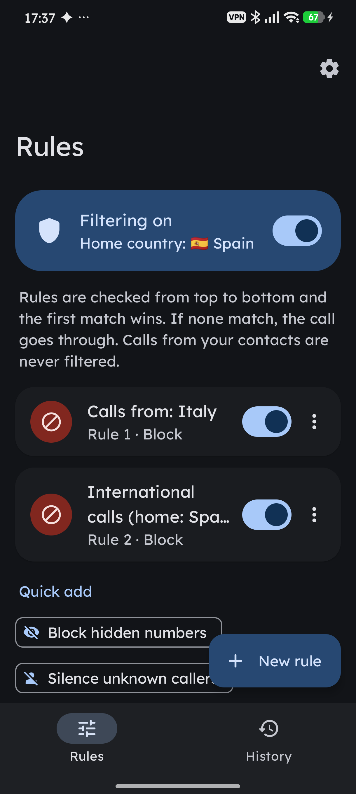
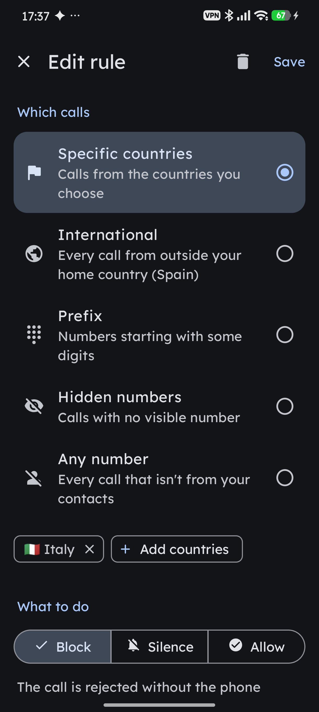
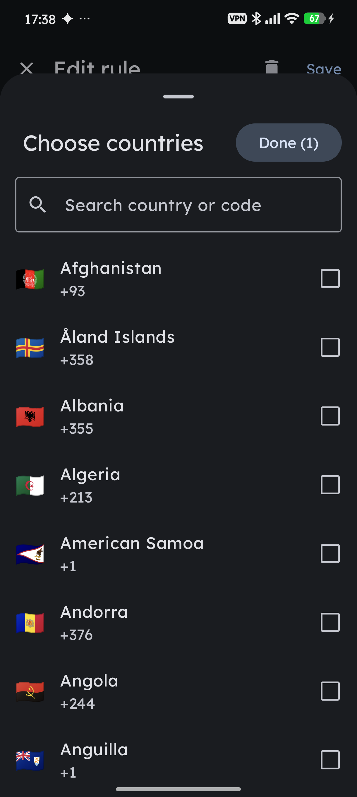
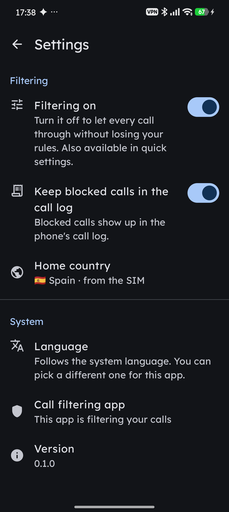

# Call Filter

*[Leer en español](README.es.md)*

An Android app that filters incoming calls with your own rules: block specific countries,
allow domestic calls only, reject hidden numbers, silence prefixes... It's built with Kotlin,
Jetpack Compose and Material 3, and it fits into the system: dynamic color (Material You),
dark theme, themed icon, a quick settings tile and per-app language.

<p align="center">
  
  
  
  
</p>
<p align="center"><sub>Rules · Editor · Country picker · Settings</sub></p>

## How it works

The app uses Android's `CallScreeningService` API. Once it holds the "caller ID & spam" role,
Android asks it about every incoming call that isn't from a saved contact, and the app decides
whether to let it through, silence it or reject it.

Rules are checked from top to bottom and the first enabled rule that matches wins. If none
match, the call goes through.

| Condition | Matches |
|---|---|
| Specific countries | numbers from the selected countries (country detected with libphonenumber) |
| International | any country other than your home country ("domestic calls only") |
| Prefix | numbers starting with some digits; with `+` it's compared with the international format, without `+` with the national number |
| Hidden numbers | calls with no number or a restricted number |
| Any number | every call that reaches the filter |

| Action | Effect |
|---|---|
| Block | the call is rejected without the phone ringing |
| Silence | the call comes in without ringing or vibrating; you can still answer it from the screen |
| Allow | the call goes through as usual; use it for exceptions above other rules |

Other features:

- **Home country**: taken from the SIM, and can be set manually. It defines what counts as
  "domestic".
- **History**: every call that goes through the filter, with the rule that was applied.
- **Quick settings**: a tile to pause or resume filtering without losing your rules.
- **Logcat**: every decision is logged with the `CallRules` tag.

## Privacy

Everything stays on the phone. The app doesn't request internet, contacts or call log
permissions. Rules, settings and history are stored as JSON in its internal storage
(`rules.json` and `history.json`).

## Languages

English (fallback language), Spanish, French, Italian, German and Portuguese. By default the
app follows the system language; on Android 13+ you can pick a different one just for this app
from Settings → Language. AGP generates `locales_config.xml` from the `values-xx` folders
(`generateLocaleConfig` + `res/resources.properties`), so adding a language only takes a new
folder. Country names come from the system itself, in the active language.

## Requirements

- Android 10 (API 29) or later.
- To build: JDK 17 and the Android SDK with platform 36.

## Build and install

```bash
./gradlew :app:testDebugUnitTest
./gradlew :app:assembleDebug
adb install -r app/build/outputs/apk/debug/app-debug.apk
```

To filter calls, the app needs the call screening role. You can grant it from the app itself
(the "Turn on" button, which opens the system dialog) or with adb:

```bash
adb shell cmd role add-role-holder android.app.role.CALL_SCREENING com.icaria.callrules
```

## Project structure

```
app/src/main/java/com/icaria/callrules/
  data/      model (rules, settings, history) and JSON repository
  engine/    number analysis (libphonenumber), rule engine, home country
  service/   RuleScreeningService (CallScreeningService)
  tile/      quick settings tile
  ui/        Compose screens: rules, editor, history, settings, country picker
app/src/test/  JVM tests for the rule engine and the JSON format
docs/screenshots/  README screenshots
```
